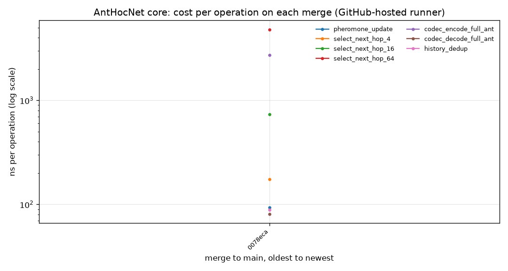

# Core speed

How long the core's hot paths take, with no simulator around them (#620).
The [benchmark results](../benchmarks.md) elsewhere measure the protocol in
ns-3. Their wall-clock (`##PERF##`, #131) mixes the core with ns-3's PHY and MAC
and moves with every scenario knob, so it cannot show that a core change made
AntHocNet slower. These numbers can.



## The cases

| case | what one operation is |
|---|---|
| `pheromone_update` | one regular-pheromone deposit on a table with 16 neighbours and 64 destinations, as a backward ant does at each node |
| `select_next_hop_4` / `_16` / `_64` | one stochastic next-hop choice for a data packet (`betaData`), with 4, 16 or 64 neighbours |
| `codec_encode_full_ant` | encoding a forward ant carrying the wire maximum of 100 visited hops (1241 bytes) |
| `codec_decode_full_ant` | decoding that frame |
| `history_dedup` | recording a new `(src, seq)` in a full dedup tracker (`maxHistory` = 4096), which evicts the oldest entry |

## Running it

```bash
make bench-core                       # table: median ns/op, min, max
make bench-core BENCH_ARGS=--csv      # what CI records
make bench-core BENCH_ARGS=--quick    # shorter rounds, for a smoke run
```

Each case is calibrated to about 0.2 s per round and measured over seven
rounds. The median is reported, with the fastest and slowest round beside it.

## How CI uses it

`core-bench.yml` runs on every PR and every merge that touches `core/`:

- **On a PR**, it builds the base branch and the PR on the same runner and runs
  them interleaved, three times each. It compares the lowest median per case
  and puts the table in the job summary. A case more than 25 % slower gets a
  warning annotation. It never fails the PR: shared runners are noisy.
- **On main**, it appends one run to
  [`results/core-bench/history.csv`](https://github.com/danieljoppi/AntHocNet/blob/main/results/core-bench/history.csv)
  with the commit and the runner's CPU model, and redraws the chart above.

Numbers compare only within one CPU model. GitHub-hosted runners change model
without notice, and a dashed line on the chart marks each change. The first
row was measured in a development container (an Intel Xeon at 2.80 GHz), not on
a runner, and is labelled that way in the CSV.
